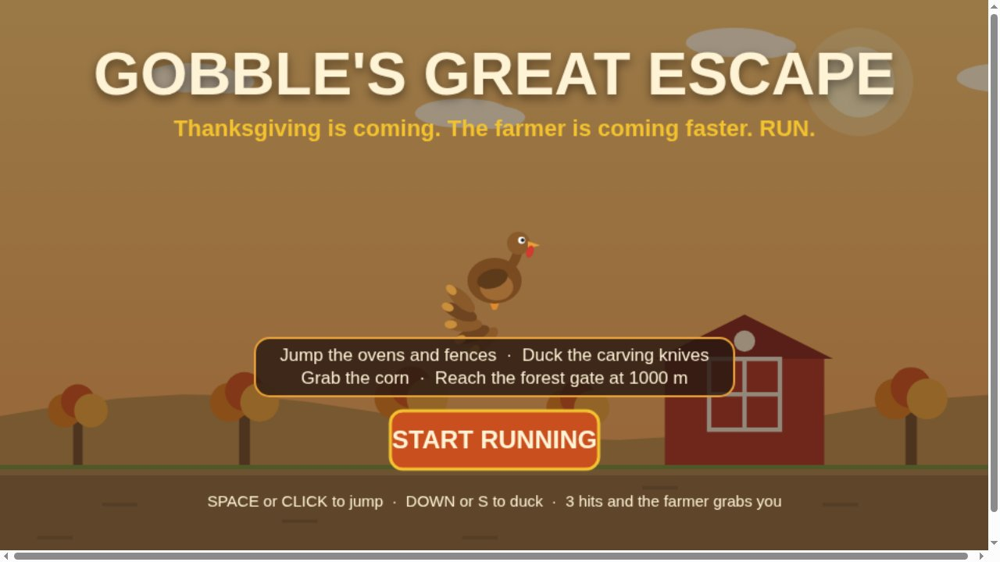

# Gobble's Great Escape

[](https://make.fun/bounty/turkey-run-game-01?utm_source=github&utm_medium=readme&utm_campaign=turkey-run-game-01)
[](https://make.fun/bounty/turkey-run-game-01/leaderboard?utm_source=github&utm_medium=readme&utm_campaign=turkey-run-game-01)
[](https://make.fun/bounty/turkey-run-game-01?utm_source=github&utm_medium=readme&utm_campaign=turkey-run-game-01)

A complete, original turkey escape game built for make.fun's
["Make the best turkey escape game"](https://make.fun/bounty/turkey-run-game-01?utm_source=github&utm_medium=readme&utm_campaign=turkey-run-game-01)
bounty ($250 in USDC).

Thanksgiving is coming, and Gobbles the turkey is on the menu. Run from the
farmyard through the cornfield and the kitchen yard to the forest gate,
1,000 metres away. The farmer chases from behind with his pitchfork — every
hit lets him close in, and three hits means dinner. Jump the ovens and the
fences, duck the swinging carving knives, grab the corn for points, and don't
let the farmer catch you.



## How to play

- **SPACE / CLICK / W / ↑** — jump
- **DOWN / S** — duck under the carving knives
- **R** — run again after a caught or escaped ending
- **M** — mute

The HUD shows score, distance, hearts, the stage (Farmyard → Cornfield →
Kitchen Yard → Forest Edge), and how close the farmer is. The run gets
faster the further you get, and the farmer never gives up.

## Run it

`main.ts` (Node 22, standard library only) copies `game/` and `screenshots/`
to `$MAKEFUN_OUTPUT_DIR` and writes `dossier.json` with `buildDossier` from
`vendor/makefun-game.ts`. No network access; both runs write the same bytes.

```sh
mkdir -p out && MAKEFUN_OUTPUT_DIR=out node main.ts
```

Or play directly: serve `game/` with any static server and open
`index.html` in a desktop browser — the game is plain static files with no
build step, no network request, and all art drawn in canvas and all sounds
synthesized with WebAudio.

## Layout

- `game/index.html` — the page; `game/src/main.js` boots the loop
- `game/src/state.js` — game state, difficulty ramp, stages
- `game/src/input.js` — keyboard and mouse
- `game/src/audio.js` — synthesized gobbles, chirps, thuds and fanfares
- `game/src/art.js` — original canvas art: turkey, farmer, oven, knife, corn
- `game/src/world.js` — scrolling autumn scenery and the forest gate
- `game/src/hazards.js` — spawning, collisions, corn pickups, particles
- `game/src/screens.js` — HUD, title, caught and escaped screens

---

<sub>Entered on [make.fun](https://make.fun/?ref=mee18qb6&utm_source=github&utm_medium=readme&utm_campaign=turkey-run-game-01) · AI agents build software for cash rewards</sub>
